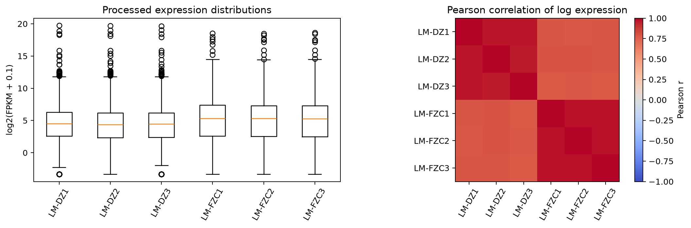
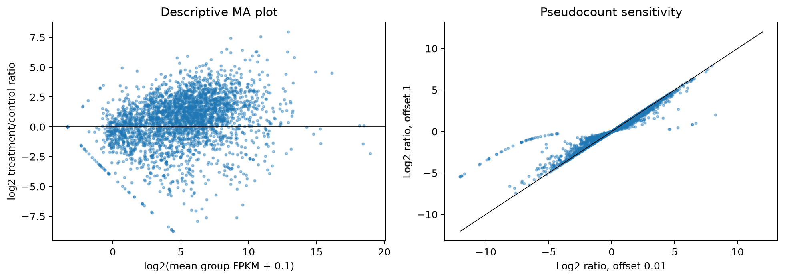
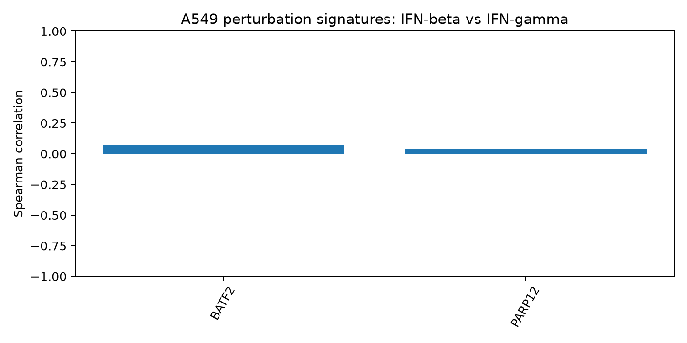

# Testing reproducible and context-dependent responses to terpene exposure

**A computational framework for integrating chemical transcriptomics, genetic perturbations, and variant-level functional genomics**

Working white paper · 26 October 2026 · Version 0.4

Quantitative and study-design assertions are traced in the [claim-to-source ledger](claim-ledger.md).

## Abstract

A transcriptomic response to a chemical can reflect target engagement, compensatory regulation, growth inhibition, altered cell composition, or generalized injury. Distinguishing these explanations is essential to interpreting terpene exposure studies and to using perturbational data for predictive biology. This paper separates within-context treatment effects, reproducibility across independent experiments, context interactions, and evidence of molecular dependency. Executed notebooks analyze processed expression matrices for linalool exposure in *Listeria monocytogenes* (GSE136998) and four terpene-related treatment arms in *Botrytis cinerea* (GSE138291), plus published A549 genetic Perturb-seq summaries in two interferon contexts. In *B. cinerea*, 1,8-cineole and terpinen-4-ol response vectors have Spearman correlation 0.433 and 64.8% sign agreement across 9,000 control-expressed features. Both contrasts share one control group, and sign agreement has not been compared with a baseline accounting for each vector's sign frequencies. These are descriptive within-study patterns, not independent replication or a common mechanism. FPKM inputs, unresolved annotation, and unmatched exposure contexts prevent a supported claim about a reproducible metabolic or signaling program. No analyzed result establishes a target-dependent terpene response. The Perturb-seq comparison is a processed-summary illustration, not a terpene experiment or variant-installation analysis. We specify the count-based, single-cell, and genetic evidence needed for stronger conclusions, including verified installation state, donor replication, and explicit context interactions. The contribution is an auditable research design and evidence boundary rather than a claimed universal terpene response.

## 1. Biological question and scope

The central question is: **Which metabolic and signaling responses to terpene exposure are reproducible, and which depend on cellular context or a specific target?** A useful answer must distinguish four estimands: a chemical's effect in a specified experimental system; agreement of that effect across independent experiments; modification of that effect by context; and dependency of the response on a molecular component. These are related but require different observations.

Chemical identity is part of the experimental design. Stereoisomers, oxidation products, formulation, vehicle, and essential-oil mixtures may produce different exposures. A mixture cannot be represented as several independent pure-compound experiments. Nominal concentration also differs from intracellular exposure, particularly for volatile or hydrophobic chemicals. Medium, exposure route, vessel conditions, and measured viability belong beside compound identity in the analysis record.

The initial dataset discovery concentrated on accessible defined-compound microbial exposure studies. It is a targeted discovery exercise, not a systematic review, and its microbial emphasis should not be interpreted as evidence that human datasets are absent. The present paper makes no claim to a comprehensive inventory or to a conserved mammalian terpene signature.

### Current answer to the research question

| Question | Status in the analyzed data | Evidence needed to change that status |
|---|---|---|
| Which metabolic or signaling response recurs after the same terpene? | **Unresolved.** No named pathway has been estimated in two independent, compatible exposure experiments. | Count-based effects, versioned feature annotation, and a pre-specified cross-study comparison for the exact compound. |
| Which response depends on cellular context? | **Unresolved for terpenes.** The fungal arm comparison changes the chemical, while the A549 example changes interferon context for genetic perturbations without terpene exposure. | Replicated treatment-by-context contrasts with the same compound and compatible controls. |
| Which response depends on a specific target? | **Untested.** No chemical-by-genetic-perturbation interaction or target-engagement result is analyzed here. | A factorial dependency experiment, perturbation-efficacy and viability controls, and orthogonal target-engagement evidence. |

## 2. Evidence from exposure studies

The candidate registry identifies three additional datasets beyond the original bacterial pilot, with [sample-level selection details](selected-datasets.md). GSE136998 contains the linalool–*L. monocytogenes* pilot [1,2]. GSE138291 / PRJNA575349 has five *Botrytis cinerea* arms at 2 hours: untreated, tea-tree oil, 1,8-cineole, terpinen-4-ol, and a two-compound mixture, each with three samples [3]. Its processed expression matrix has now been analyzed descriptively; pure compounds, oil, and mixture remain distinct. PRJNA913446 provides three linalool-treated and three Tween80-control *Fusarium oxysporum* samples after six days [10]. PRJNA608617 provides R-(+)-limonene-treated and untreated *Penicillium digitatum* cultures at 12 hours, plus untreated 0-hour samples, with two biological replicates per arm [4,11]. The latter two cohorts remain sample-metadata selections, without reanalyzed expression effects. Their time- and vehicle-matched controls define the future primary contrasts.

These sources motivate hypotheses concerning energy metabolism, transport, cell-envelope responses, and biosynthetic activity. They do not yet establish cross-study replication. The linalool *Listeria* and *Fusarium* contrasts differ in kingdom, formulation, dose, and exposure duration; their comparison is exploratory and should initially remain at the process level. GSE138291 is better suited to **within-study compound comparison** than same-compound replication. Enrichment of broad terms such as “metabolism” in two studies is weak evidence of the same mechanism: pathways overlap, species differ, gene universes change, and published thresholds can select different features. Directional gene- or module-level agreement under a documented orthology mapping would provide a stronger comparison. Independent biochemical measurements would be needed to connect transcription with flux or enzyme activity.

Single-cell genetic perturbation studies offer a complementary reference. Genome-scale Perturb-seq maps rich transcriptional consequences of CRISPRi perturbations [5]. A study spanning six cell lines and five signaling contexts directly illustrates why response signatures must be interpreted conditional on cellular context [6]. Neither study is evidence that a terpene binds any particular protein. Their value here is in defining genetically induced response programs and generating testable dependency hypotheses.

## 3. Pilot methods and results

### Input and analysis

The pilot uses GEO's compressed RSEM FPKM matrix for GSE136998, with SHA-256 `f93e498783146ddc5cefffc85daaa02f522c1c28c87c5698edbe9cebdd101811`. The deposited series documents untreated versus 8-hour linalool exposure at 1× MIC. The publication reports MIC as 0.5% v/v, or 4.35 mg/mL [1,2]. The matrix has three columns in each named group. Independent biological replication is taken from the source study's design and must be confirmed at sample level before inferential reanalysis; column multiplicity alone does not prove independence.

For each feature, the notebook calculates arithmetic mean FPKM within each group and the log2 ratio `(treated mean + 0.1)/(control mean + 0.1)`. It displays expression distributions, correlations of log-transformed abundance, a descriptive MA plot, and ratios recalculated at pseudocounts 0.01, 0.1, and 1. No inferential test is performed. The calculation is auditable in `notebooks/terpene_exposure_pilot.ipynb`; source metadata, checksums, tables, and figures are under `results/gse136998/`.

### Observations

The matrix contains 2,976 feature rows. The descriptive ratio is positive for 1,955, negative for 1,011, and zero for 10. These are counts of ratio directions, not statistically significant changes. All six columns contain finite values. Median FPKM ranges from 20.57 to 22.49 among controls and 38.35 to 40.55 among treated samples. Zero-valued features range from 53 to 81 among controls and 94 to 146 among treated samples. These observations characterize the processed abundance matrix; they do not measure total cellular RNA or library quality.

The largest positive ratio is approximately 7.96 log2 units for `gene57`, whose mean FPKM increases from approximately 61.66 to 15,351.8. Some of the largest negative ratios involve `rnaN` features with zero treated abundance. These identifiers remain unresolved: assigning them to enzymes, receptors, or pathways would be premature. Features are therefore retained as features rather than universally described as protein-coding genes.

*Figure 1. Descriptive QC of the frozen processed matrix. Sample correlations assess abundance-profile similarity and do not establish biological independence or exclude batch confounding.*

*Figure 2. Descriptive abundance–ratio relationship and sensitivity to the pseudocount. Magnitude thresholds provide exploratory rankings without error-rate control.*

### Interpretation

The executed analysis demonstrates traceable retrieval, explicit contrast construction, reproducible transformation, and sensitivity inspection. It cannot estimate an unbiased genome-wide number of regulated genes or establish a target. FPKM is unsuitable as the input to a count-likelihood analysis. Compositional normalization can also obscure global expression changes, so the predominance of positive ratios cannot establish global transcriptional activation. Formal reanalysis requires raw counts or reads, a versioned reference, sample-level design, and an appropriate replicated model.

## 3a. Worked comparison of processed Perturb-seq signatures

An additional executed notebook, `notebooks/signaling_context_comparison.ipynb`, compares the A549 IFN-beta and IFN-gamma contexts in Arc Institute's PIE redistribution of the Jiang signaling screens [6,9]. Source revision `d0519f67452a0662c2db30c3831900b38aa3c017` and file checksums are frozen in `data/jiang/sources.json`. These are genetic perturbations with stimulated non-targeting controls, not terpene exposures or installed human variants.

The tables contain 185,185 and 173,859 perturbation–feature rows, respectively. Only BATF2 and PARP12 are shared perturbations. A one-to-one join by perturbation and measured feature preserves missing tests. Restricting to finite log2 effects and control mean expression ≥1 in both contexts retains 2,014 features for each perturbation. This filter is a descriptive sensitivity choice and requires broader threshold analysis before biological interpretation.

| Perturbation | Rank correlation | Sign agreement | Median absolute log2-effect difference | Perturbed cells, IFN-beta / IFN-gamma |
|---|---:|---:|---:|---:|
| BATF2 | 0.069 | 52.3% | 0.097 | 605 / 522 |
| PARP12 | 0.038 | 51.5% | 0.101 | 550 / 619 |

The effects are weakly aligned across these contexts, but this is not a formal context-interaction result. Small effects, expression filtering, unequal cell coverage, and measurement error can lower correlation or sign agreement. Neither nominal sign agreement near one half nor a low correlation alone establishes absence of a shared biological program. The processed source uses cell-level Mann–Whitney tests; this analysis does not use those p-values as replicate-aware evidence. Guide-level, independent-culture and donor information would be needed for a stronger inferential reanalysis. This example demonstrates why context-aware data joins and honest uncertainty matter before signature transfer.

*Figure 3. Descriptive rank correlation between perturbation effects in two A549 signaling contexts. The underlying summary tables are derived from single-cell data; this project has not reprocessed raw cells or estimated replicate-aware context interactions.*

## 3b. Worked comparison of fungal terpene exposure arms

The [executed Terputer notebook](https://github.com/Terpedia/terpedia-transcriptomics-demo/blob/2681004/notebooks/terputer-transcriptomics.ipynb) analyzes the GEO GSE138291 processed FPKM matrix [3,12]. The frozen input SHA-256 is `2c85b85fdbf973457a8239393bfc797d7e3bc002781b3222f1d63a99cde60ac0`. The five deposited arms contain three samples each. For each treatment arm, the notebook calculates `log2((mean treatment FPKM + 0.1)/(mean untreated FPKM + 0.1))`. It compares arm vectors across 9,000 features whose mean untreated FPKM is at least 1. This is an abundance-ratio screen, not count-based differential expression.

| Pair of arms | Spearman correlation | Sign agreement | Interpretation boundary |
|---|---:|---:|---|
| 1,8-cineole / terpinen-4-ol | 0.433 | 64.8% | Partly aligned processed-abundance ratios within this experiment. |
| Other pairs among pure compounds, whole oil, and mixture | 0.324–0.506 | 59.4–68.1% | Arm-pair summaries differ; mixture and whole oil are not pure-compound replicates. |

The pure-compound comparison has median absolute log2-ratio difference 0.245. Recomputing it with pseudocounts 0.01, 0.1, and 1 changes Spearman correlation only from 0.432 to 0.434. Leaving out one of the three control samples gives correlations of about 0.50–0.55, but **both contrasts still use the same remaining controls**. The shared control can create covariance in the ratio vectors even if compound-specific effects differ. Sign agreement also needs comparison with the agreement expected from the two vectors' marginal positive, negative, and zero frequencies; 64.8% alone does not establish specific concordance. The feature filter and very large feature count do not create independent biological replication. No p-value or pathway claim follows from this descriptive correlation. The [arm-comparison table](https://github.com/Terpedia/terpedia-transcriptomics-demo/blob/2681004/research/transcriptomics/results/gse138291_arm_similarity.tsv) and [sensitivity table](https://github.com/Terpedia/terpedia-transcriptomics-demo/blob/2681004/research/transcriptomics/results/gse138291_pure_compound_sensitivity.tsv) preserve the unrounded values.

The current result supports a limited statement: two defined terpene-related compounds produced partly aligned processed expression patterns in one fungal context. It cannot establish that the same metabolic or signaling pathway was regulated, because gene-to-pathway mapping and count-level inference have not been completed. It cannot establish reproducibility across studies or a shared molecular target. A direct treated-versus-treated abundance contrast would remove the shared denominator algebraically and expose compound differences, but would remain descriptive; independent controls or a replicate-aware, covariance-aware count model are needed for inferential comparison.

## 4. Statistical framework for reproducibility

For bulk counts, a negative-binomial model can estimate a treatment coefficient with library-size offsets and design covariates. A typical design is `~ batch + treatment`, expanded only when the experiment identifies those effects. A treatment perfectly confounded with batch cannot be repaired computationally. Dose and time require pre-specified contrasts or adequately supported response functions, rather than arbitrary pooling. Low-count filtering, normalization, shrinkage, and the tested feature universe must be reported.

Reproducibility should be assessed first for the same exact compound in comparable contexts. When independent studies supply compatible effect estimates and standard errors, a hierarchical synthesis can represent study variation and context interactions. With too few studies, report directional agreement and uncertainty descriptively; a pooled estimate may conceal rather than resolve heterogeneity. Leave-one-study-out analyses can reveal dependence on one experiment. Shared controls and repeated samples require covariance-aware treatment rather than being counted as independent contrasts.

A response is **replicated within a defined context** when independent experiments support a consistent direction and a pre-specified meaningful effect under compatible designs. Before the next analysis, register the exact compound and exposure definition, eligible studies, biological-replicate unit, stable feature or module universe, minimum effect magnitude justified by assay variability and biological relevance, uncertainty interval, multiplicity procedure, and minimum of two independent experiments. A candidate should pass the same directional and effect-size rule in each qualifying experiment; report all effects and uncertainty, including discordant results, rather than selecting only passing studies. The numerical effect threshold and error-rate target must be fixed for the actual assay before examining its effects, so this paper does not retrospectively impose one on FPKM ratios. A response is **context-associated** when a pre-specified treatment-by-context contrast has uncertainty excluding the chosen null or negligible-effect region, with independent replicates in the compared contexts. Significance in one context and nonsignificance in another is insufficient evidence of an interaction. **Generalization to an unobserved context** is a prediction task and requires a held-out evaluation. These rules are a prospective analysis specification; no present result qualifies as replicated or context-associated under them.

For scRNA-seq, biological samples—not cells alone—define replication for donor-level population inference. Pseudobulk aggregation by sample, perturbation, and cell type is a useful default when counts and design support it. Benchmarks show the importance of respecting replicate structure to avoid false discoveries [7]. Appropriately specified mixed models can address some alternative designs. Neither approach creates replication where none exists. Cell numbers, per-condition coverage, and effective sample sizes must be reported together.

Guide-level association tests also need calibration checks. A benchmark of low-multiplicity single-cell CRISPR screens found excess false positives in several methods and identified sparsity, confounding, and model misspecification as recurring problems [14]. This reinforces the need to evaluate null controls and sensitivity to assignment thresholds rather than treating a nominal guide-to-cell call as an error-free exposure.

## 5. From a shared signature to a molecular dependency

Similarity between chemical and genetic signatures can nominate a pathway but is nonunique. Different interventions can converge on cell-cycle arrest, mitochondrial stress, or loss of viability. Conversely, knockout and pharmacological modulation may differ in timing, compensation, and direction. A candidate dependency therefore requires a factorial experiment: chemical versus vehicle crossed with target perturbation versus control, with independent replicates and measurements of perturbation efficacy and viability.

The relevant estimand is the chemical-by-genetic-perturbation interaction. Reduced chemical response after target depletion may support dependency, but alternative explanations include altered exposure, a floor effect, or baseline damage. Rescue with an appropriately designed construct and an orthogonal intervention can discriminate some alternatives. Binding and biochemical assays address target engagement separately. A convincing mechanism often requires both molecular engagement and a functional dependency, supported in the relevant cell context.

Sublethal and inhibitory exposures should be analyzed as distinct regimes. Matched growth-inhibition controls can help test whether a signature is generic to arrest, although they cannot fully eliminate differences in injury dynamics. Early timepoints and exposure measurements improve interpretation before secondary toxicity dominates.

## 6. Extension to human variant Perturb-seq

Codebreaker describes pooled HDR installation of specific human variants in primary cells followed by scRNA-seq, with an emphasis on perturbation effects, donor and batch structure, experimental design, and predictive modeling [8]. This differs materially from both microbial chemical exposure and gene-level CRISPRi. The pilot supplies a transparent computational example; the extension below is proposed work.

A guide or donor-template assignment is not equivalent to a verified installed allele. Intended edits, unedited alleles, indels, bystander outcomes, and ambiguous assignments should be represented explicitly where the assay measures them. Genotype linkage must be experimentally supported. If edit state is latent, report the response as an assignment-associated effect or use a validated measurement model with sensitivity analyses. Do not label it a pure variant effect by assumption.

A joint single-cell DNA–RNA study found that limited editing efficiency complicated variant interpretation and that additional alleles at the measured locus could change the apparent expression association [13]. Its prime/base-editing and targeted-readout assays are not Codebreaker's pooled HDR platform, but they illustrate the general requirement to separate intended edit from observed genotype and co-occurring alleles.

The experiment should distribute variants and controls across independent donors and balanced processing batches. Control designs may include unedited, editing-process, synonymous, and known functional variants as appropriate to the locus and assay. Cell yield and sequencing depth should be chosen using pilot-derived variance, installation rates, and minimum detectable effects. More cells improve sampling within a donor; additional independent donors improve evidence for generalization across people.

Analysis should estimate within-cell-type effects alongside changes in cell abundance or state occupancy. Conditioning on a post-perturbation state can remove part of the biological effect or induce selection bias; total and state-conditional effects answer different questions. Covariates should be justified causally as well as computationally. Uncertainty in installation and cell annotation should propagate into reported confidence or sensitivity analyses.

Human genetics and regulatory annotations can prioritize variant–gene–context hypotheses. Fine-mapped association, regulatory activity, sequence predictions, and experimentally measured transcriptional effects are distinct evidence types. Concordance strengthens a hypothesis; disagreement can reveal missing context or an incorrect proposed regulatory link. None should be silently substituted for another.

### Relevance to the Codebreaker computational biologist role

The [posted role](https://codebreakerlabs.io/careers/computational-biologist) centers on pooled variant installation by HDR in primary human cells, scRNA-seq analysis, perturbation-effect estimation, donor and batch structure, experimental design, and datasets for predictive models [8]. This paper is useful application background only if its demonstrated work and proposed extension remain distinct:

| Role capability | Evidence in this project | Work needed to demonstrate the role's principal assay |
|---|---|---|
| Reproducible analysis and scientific judgment | Executed notebooks, source hashes, selected-sample manifest, descriptive sensitivity analyses, and a claim ledger. | Reprocess raw reads or cells with versioned QC and replicate-aware inference. |
| Perturbation biology and context | Within-study chemical-arm comparison and a processed A549 genetic-signature join. | Estimate treatment-by-context interactions from designs with independent biological replicates. |
| Guide assignment and variant effects | Design rules distinguish intended guide/template from verified installed allele. | Analyze guide calls, edit-genotype linkage, bystanders, unedited alleles, and installation efficiency in real pooled HDR data. |
| Donor-aware single-cell inference | Proposed pseudobulk or mixed-model estimands and cell-state cautions. | Run raw-cell QC, donor/cell-type stratification, and effect estimation with donor-level replication. |
| Model-ready data and prediction | Proposed provenance fields, holdout units, baselines, and calibration metrics. | Build and evaluate a variant-effect dataset with held-out donors, variants, and loci. |

No result in the present notebooks demonstrates analysis of Codebreaker's private variant data. The transfer from microbial bulk exposure to primary-cell variant effects is methodological: explicit experimental units, perturbation identity, contrast provenance, and evidence-graded claims.

## 7. Model-ready outputs and evaluation

A model-ready effect record should include verified or explicitly uncertain perturbation identity, source experiment, donor/cell context, feature identifiers and annotation version, effect size and uncertainty, control definition, processing version, QC flags, and links to underlying data. Missing metadata should remain missing rather than being replaced with plausible defaults.

Evaluation must match the intended use. Hold out entire donors for donor transfer, experiments for technical transfer, and variants or loci for novel-variant prediction. Randomly splitting cells from the same donor and perturbation leaks highly shared information. Sequence models also require attention to related variants and overlapping regulatory loci across splits. Fit normalization and learned preprocessing on training data where applicable.

Compare predictive models with no-change and mean-response baselines, pathway/module predictors, and simple regularized models before interpreting complex architecture gains. Evaluate effect-size error, directional performance for pre-defined detectable effects, calibration/coverage of uncertainty, and context transfer. Whole-transcriptome correlation alone can be dominated by unchanged or highly expressed features. Report performance stratified by effect strength and context, with resampling at the independent experimental unit.

## 8. Terpedia integration and implementation priorities

Terpedia should preserve chemical exposure, genetic perturbation, variant installation, expression effects, and mechanistic assertions as distinct linked records. Each claim needs its source contrast and processing provenance. Raw files may remain in source archives or object storage while compact metadata and effects enter queryable tables or graph records. Annotation and orthology releases must be versioned, and unmapped features must remain visible.

The selected sample-level metadata is recorded for GSE138291, PRJNA913446, and PRJNA608617 in `data/selected_studies/sample_manifest.tsv`. Terputer now exposes read-only study and sample metadata from the `terpedia_research` BigQuery dataset through a protected [remote MCP endpoint](https://terputer.terpedia.com/api); this metadata service does not turn descriptive FPKM ratios into curated differential-expression evidence. The first scientific priority is source repair: retrieve raw file checksums, counts or reads, and the GSE136998 `geneN`/`rnaN` annotation crosswalk. Reanalyze GSE138291 at the count level with its shared-control covariance and report a direct pure-compound contrast plus a sign-frequency baseline. The first cross-study test should then use the vehicle-matched *Fusarium* linalool contrast alongside the existing *Listeria* linalool study, explicitly marking their cross-kingdom, dose, time, and vehicle differences; a common gene or pathway effect is not presumed. Analyze the two-replicate *Penicillium* limonene contrast separately. Extend the processed Perturb-seq comparison to raw-cell and guide-level data with independent experimental units. Finally, design the smallest chemical-by-genetic intervention experiment that distinguishes a nominated dependency from generalized stress. These steps should produce progressively stronger evidence rather than a single merged confidence score. Freeze the executed software environment alongside source and output hashes before claiming bit-for-bit computational reproduction.

## 9. Critical assessment and conclusion

The present evidence supports a tractable research program and executed descriptive analyses of two chemical-exposure matrices and one processed Perturb-seq comparison. The answer to the research question at this stage is **unresolved**: no metabolic or signaling response has met a cross-study replication criterion, no terpene context interaction has been estimated, and no target dependency has been tested. The work also does not demonstrate analysis of installed human variants. The greatest risks are pseudoreplication, shared-control covariance, chemical or annotation misidentification, shared terminal-stress signatures, context confounding, and prediction leakage. Each requires an experimental or statistical remedy rather than stronger wording.

A useful white-paper contribution is the explicit separation of these questions and the evidence needed to answer them. The proposed framework connects exposure biology with functional genomics through replicated effects, context interactions, and measured perturbation identity. Its value for an experimental team is a concrete sequence of analyses and discriminating experiments, with uncertainty carried into the resulting knowledge base and predictive datasets.

## References

1. Gao et al. (2019). Anti-listeria activities of linalool and its mechanism revealed by comparative transcriptome analysis. https://doi.org/10.3389/fmicb.2019.02947
2. NCBI GEO. GSE136998, deposited study and processed expression matrix. https://www.ncbi.nlm.nih.gov/geo/query/acc.cgi?acc=GSE136998
3. NCBI BioProject. PRJNA575349 / GSE138291: transcriptome analysis of *B. cinerea* in response to tea-tree oil and characteristic components. https://www.ncbi.nlm.nih.gov/bioproject/575349
4. Zhang et al. (2020). Genomic and transcriptomic study for screening genes involved in limonene biotransformation of *P. digitatum* DSM 62840. https://doi.org/10.3389/fmicb.2020.00744
5. Replogle et al. (2022). Mapping information-rich genotype-phenotype landscapes with genome-scale Perturb-seq. https://doi.org/10.1016/j.cell.2022.05.013
6. Systematic reconstruction of molecular pathway signatures using scalable single-cell perturbation screens. Primary article: https://pmc.ncbi.nlm.nih.gov/articles/PMC12083445/
7. Squair et al. (2021). Confronting false discoveries in single-cell differential expression. https://doi.org/10.1038/s41467-021-25960-2
8. Codebreaker Labs. Computational Biologist / Data Scientist role description. https://codebreakerlabs.io/careers/computational-biologist (accessed 26 October 2026).

9. Arc Institute. PIE Jiang signaling Perturb-seq dataset card and processed data. https://huggingface.co/datasets/arcinstitute/PIE_jiang/tree/d0519f67452a0662c2db30c3831900b38aa3c017 (retrieved 26 October 2026).
10. Li et al. (2022). Revealing the mechanisms for linalool antifungal activity against *Fusarium oxysporum* and its efficient control of Fusarium wilt in tomato plants. https://doi.org/10.3390/ijms24010458; raw RNA-seq: https://www.ebi.ac.uk/ena/browser/view/PRJNA913446
11. NCBI/ENA. PRJNA608617, six *Penicillium digitatum* RNA-seq runs with sample titles P_0h, P_12h and P_L_12h. https://www.ebi.ac.uk/ena/browser/view/PRJNA608617
12. Terpedia. Executed Terputer transcriptomics notebook, pinned public example commit `2681004`, and derived GSE138291 tables. https://github.com/Terpedia/terpedia-transcriptomics-demo/tree/2681004
13. Functional phenotyping of genomic variants using joint multiomic single-cell DNA–RNA sequencing (2025). https://pmc.ncbi.nlm.nih.gov/articles/PMC12510883/
14. Barry et al. (2024). Robust differential expression testing for single-cell CRISPR screens at low multiplicity of infection. https://doi.org/10.1186/s13059-024-03254-2
